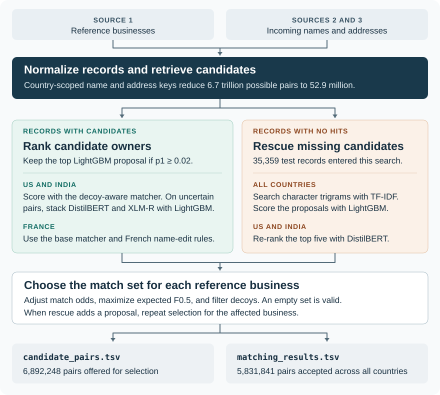

# Business Entity Resolution: Amazon ML Challenge 2026 (team Ekdant.exe)

This project matches noisy business records (Source-2 and Source-3) to a reference table (Source-1) in the US, India and France. The test set also contains deliberate **decoys**: near-copies of a business that belong to nobody.

- **Final submission: v21** (`run_v21.sh`). The metric is macro F0.5 per Source-1 entity.
  - v21 = v20 plus a cross-encoder in the rescue step; local +0.0002 over v20.
  - Public leaderboard history: v20 **0.989191**, v19 0.989000, v17 0.988917, v15 0.986916, v12 0.985429.
- **Model:** a LightGBM matcher, plus two small GPU cross-encoders (DistilBERT, XLM-R) stacked on the uncertain pairs, plus a cross-encoder that re-scores the rescue candidates.
- **Candidate set:** 3.98 candidates per Source-1 entity.
- **New here?** Read [`CONTEXT.md`](CONTEXT.md) (status, plan, rules) and [`APPROACHES_AND_LESSONS.md`](APPROACHES_AND_LESSONS.md) (everything tried, what worked, what failed).

## Architecture



Each incoming record can propose one reference business. Each reference business can accept several records or return an empty match set.

## How it works (one paragraph)
1. **Blocking.** Composite keys over name and address tokens, scoped by country, find about 50 candidate Source-1 entities per record.
2. **Stage-1 ranker.** A LightGBM ranker keeps each record's single best candidate (p1 ≥ 0.02).
3. **Stage-2 matcher.** A decoy-aware LightGBM matcher scores that pair. It uses name/address similarity, house-number offset features, legal-form swaps, decoy-word scores and cluster context. It is trained with decoys weighted ×2.6, because the test has about 3× more decoys than train.
4. **Cross-encoders (v17–v21).** Small multilingual transformers (DistilBERT, XLM-R) read both texts together and re-score only the uncertain pairs (0.002 < p2 < 0.998). A LightGBM stacker (v20) combines them with p2. The same kind of model also re-scores the rescue search's top-5 candidates (v21).
5. **Selection.** Scores are shifted to each country's test prior. For every Source-1 entity, the set of records with the highest **expected F0.5** is chosen, and "nothing" is one of the options.
6. **Post-processing.** A decoy post-filter, label-free France rules and a rescue search for records without any candidate. France keeps the v13 decisions.

## Folder layout
```
README.md                  this file
CONTEXT.md                 current status, plan, decision rules, user preferences (read first)
APPROACHES_AND_LESSONS.md  version history, findings, lessons, mistakes, tried-and-dropped ideas
DEEP_ANALYSIS.md           where the remaining errors are, per-country facts, leak checks, research, what could reach 0.99+
requirements.txt
run_all.sh                 first-time training of the stage-1 ranker (crossfit.py) + transliteration dictionary (+ the v1 baseline)
run_v15.sh                 v15 pipeline (LB 0.986916): dataset -> output/matching_results.tsv + candidate_pairs.tsv
run_v16.sh                 v15 + training subset T4 + K x1.5 prior shift for US/India
run_v17.sh                 v17 (LB 0.988917): v16 + GPU cross-encoder (part 1 of it also prepares v19)
run_v19.sh                 v19 (LB 0.989000): v17 with two cross-encoders (DistilBERT + XLM-R) + rescue fix
run_v20.sh                 v20 (LB 0.989191): v19 with a LightGBM stacker (src/xenc_stack_gbm.py) + K x1.75
run_v21.sh                 FINAL: v20 + cross-encoder re-scoring of the rescue candidates (src/xenc_rescue.py)
models/                    trained models used for the submitted files
src/                       pipeline code (table below)
evaluation/                evaluation engine: local mini-leaderboard + label-free test checks + light validator
  deep/                    deep-analysis scripts (loss breakdown, miss kinds, twin rates, offset cells, leak checks)
gpu_crossencoder/          Colab notebooks for the 3 cross-encoder runs (v17 DistilBERT, v19 XLM-R, v21 rescue) + requirements-gpu.txt
```

## Run (final v21)
```bash
pip install -r requirements.txt
DS=/path/to/student_resource/dataset
# (optional, first time) rebuild the stage-1 ranker: bash run_all.sh $DS work out_v1
#   then copy work/model_stage1_* and work/model_stage2_cf.* into models/ (models/ already holds the trained copies)

# 1. CPU pipeline up to the v16 matcher + export of the uncertain pairs for the GPU  (about 5 h on 2 cores)
bash run_v17.sh $DS work output
# 2. GPU (free Colab T4): gpu_crossencoder/xenc_colab.ipynb and gpu_crossencoder/xenc2_xlmr_colab.ipynb
#    with the files in work/colab  ->  xenc_scores.csv(.gz), xenc2_scores.csv(.gz)
# 3. stack the two cross-encoders (v20)
bash run_v20.sh $DS work output xenc_scores.csv xenc2_scores.csv
# 4. export the rescue candidates, then GPU: gpu_crossencoder/xenc3_rescue_colab.ipynb
#    (xtrain parts from work/colab + xextra parts from work/colab3)  ->  xenc3_extra_scores.csv(.gz)
python3 src/xenc_export_rescue.py work work/colab3
# 5. final v21
bash run_v21.sh $DS work output xenc3_extra_scores.csv
python3 /path/to/student_resource/utils/validate_submission.py \
    --matching output/matching_results.tsv --candidate output/candidate_pairs.tsv --test-dir $DS/test
```
- The CPU steps take about 5 hours on 2 cores, with peak RAM under about 6 GB (everything is chunked). The three GPU runs take about 35–70 minutes each on a T4.
- Older versions can be rebuilt with `run_v15.sh` … `run_v20.sh`.
- `evaluation/check_submission.py` does the validator's checks with little memory.

## Pipeline steps (`run_v15.sh`)
| # | script | what it does |
|---|---|---|
| 1 | `src/convert.py` | TSV → parquet (all strings, tab separator) |
| 2 | `src/prep.py`, `src/normalize.py` | normalise names/addresses: Indic transliteration (`src/resources/indic_token_dict.json`, learned by `learn_translit.py`), accents, leet-speak, legal forms, street abbreviations, states, numbers, PIN |
| 3 | `src/run_blocking.py` (`keys.py`, `blocking.py`) | composite-key blocking, per-kind frequency caps, top 50 by summed IDF |
| 4 | `src/build_features.py` (`features.py`), `src/select_T.py` | about 64 pairwise features for the held-out subsets V (3% of train Source-1), T (4%) and the test |
| 5 | `src/stage2_v2.py prep_train / train_cf / predict` (`stage2.py`, `decoy_features.py`, `train.py`, `metrics.py`) | v10 decoy-aware matcher: out-of-fold stage-1 scores, cluster context, negatives ×2.6, prior shift, expected-F0.5 selection |
| 6 | `src/decoy_postfilter.py --refit --hidden` | removes pairs in an entity's positive house-number offset cells |
| 7 | `src/france_fix2.py` (`france_fix.py`) | France: reject business-type-word swaps, accept noise suffixes (count-profile rules) |
| 8 | `src/rescue_queries.py`, `rescue_cands.py`, `rescue_score.py`, `rescue_apply.py` | TF-IDF rescue search for records with no candidate; re-runs the selection for those entities |
| 9 | `src/select_T2.py`, `build_features.py trainT2`, `prep_T2.py` | extra training subsets T2, T3 (10% of train Source-1 each) |
| 10 | `src/stage2_v14.py train / predict` (`extra_feats.py`, `extra_test.py`) | v15 matcher: + positional house-number features, 3.9× rows; upward-offset pairs capped at the v10 score; one process per country |
| 11 | steps 6–8 again on the v15 scores, then `src/merge_countries.py` | final file: US+India from v15, France from v13 |

`candidate_pairs.tsv` is exactly the set the final decision layer scores: each record's best entity (6.87M pairs) plus 22.7K rescued pairs, 3.98 per Source-1 entity. Every matched id is in it.

**Candidate generation scales.** No record is ever compared with every other record. Each record looks up its own keys in a hashed inverted index of Source-1, and per-key frequency caps bound the work, so the cost is linear in the number of records.

| stage | pairs | per Source-1 entity |
|---|---|---|
| all pairs within a country (never computed) | about 6.7 × 10¹² | about 3.9M |
| key retrieval | 52.9M | 30.5 |
| learned ranker, best entity per record (+ rescue) | **6.89M** | **3.98** |
| final matches | 5.83M | 3.36 |

On labelled held-out train entities the candidate set keeps 97.7% of the true pairs, with 3.62 candidates per entity against 3.47 true matches per entity.

## Evaluation engine (`evaluation/`, details in `evaluation/README.md`)
| tool | what it tells you | labels needed |
|---|---|---|
| `evaluate.py` (engine: `src/local_eval.py`) | local leaderboard for US+India at the test decoy density; agrees with the LB within about 0.0004 | train labels |
| `prof_diff.py` | per-country decoy share of the pairs a new file adds or removes (count profile) | none (works for France) |
| `sym_check.py` | accepted +k vs −k house-number offsets on the test: excess = decoys accepted | none |
| `check_submission.py` | format checks with low memory (row count, ids, every match inside the candidates) | none |
| `deep/loss_breakdown.py`, `deep/miss_kinds.py` | oracle gain per error bucket; what kind of true pairs are missed | train labels |
| `deep/twin_rates.py`, `deep/offset_cells.py`, `deep/leak_checks.py` | coin-flip record rates per country; test offset cells vs local reference; id/row leak checks | none / train labels |

## Models and licences
- v15 and v16 use only LightGBM models (MIT), trained on the provided train data, with no external data, APIs or pretrained models.
- v17 adds one pretrained model: `distilbert-base-multilingual-cased` (Apache-2.0, 135M parameters, far below the 8B limit). v19 adds a second one: `xlm-roberta-base` (MIT, 278M). It is fine-tuned only on the provided train pairs on a free Colab T4 GPU. Its stacker coefficients are in `models/xenc_stack_v17.json`, and the fine-tuned weights are rebuilt by the notebook (about 30 minutes).
- `models/`:
  - `model_stage1_f0/f1.txt` + `model_stage1_cf.json`: stage-1 ranker (2 folds).
  - `model_stage2_cf.*`: the base feature list read by `stage2_v2.py`.
  - `s2v2_cf_final.txt`: v10 matcher. `s2v2_cf_final_dw.txt`: decoy-word model.
  - `s2v2_cf_v15.txt` + json: v15 matcher. `s2v2_cf_v16.txt` + json: v16 matcher.
  - `xenc_stack_v17.json` / `xenc_stack_v19.json`: cross-encoder stacker coefficients. `xenc_stack_gbm_v20.txt`: the v20 LightGBM stacker. `xenc_rescue_v21.json`: the v21 rescue stacker.
  - `model_rescue.txt`: rescue model.
  - The run rebuilds all stage-2 and rescue models in `work/`; these copies document the submitted file.
